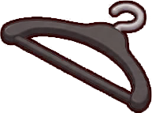
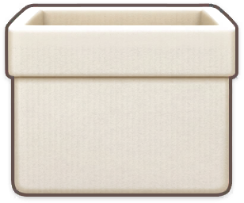
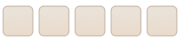
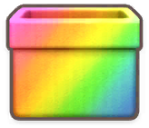
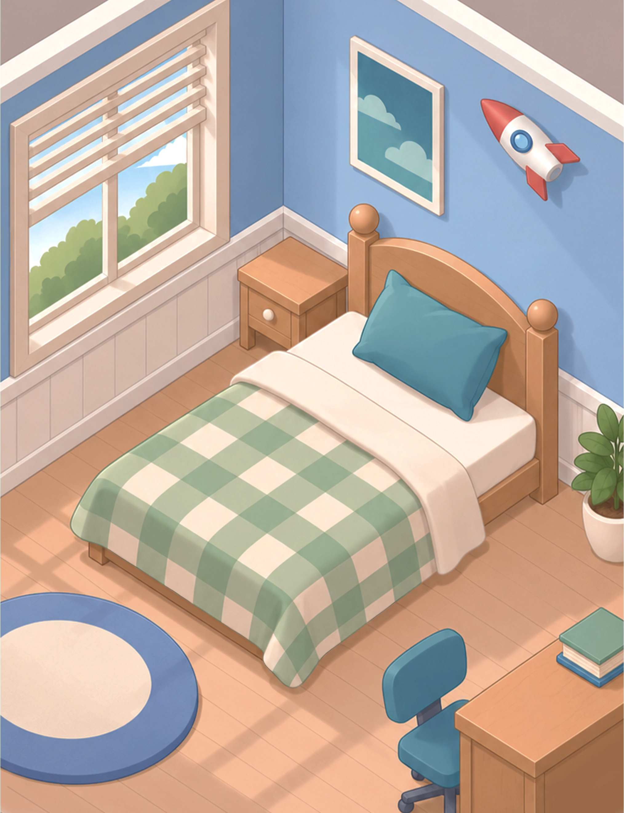

# Object

[← Mục lục GDD](GDD.md)

Ảnh bên dưới là tham chiếu Happy để giải thích đối tượng; hình chính thức sẽ lấy từ Tidy Room.

| ID | Đối tượng | Vai trò | Ảnh |
|---|---|---|---|
| O-001 | Đồ vật thu gom | Các món đặt rải và chồng lên nhau trong phòng. Mỗi món thuộc một nhóm nhận. |  |
| O-002 | Hộp đang mở | Hiển thị nhóm cần thu và bộ đếm. Ban đầu mở 2 hộp. |  |
| O-003 | Hộp khóa | Vị trí hộp bổ sung. Extra Box mở thêm hộp, tối đa 3 hộp cùng lúc. |  |
| O-004 | Slot chờ | Ban đầu có 5 slot. Mỗi slot giữ một item chưa có hộp nhận; có 2 slot bổ sung. |  |
| O-005 | Kho tạm | Nhận item từ Broom để giải phóng khay chờ. Đồ trong kho vẫn thuộc số đồ cần thu. |  |
| O-006 | Bối cảnh | Nền phòng và nội thất giúp định hướng bộ đồ, bố cục và vùng tìm kiếm. |  |

Hộp khóa là vị trí hỗ trợ sức chứa, không phải Element gây khó của level. Số lượng cần thu được đặt theo từng hộp, không cố định ba món cho mọi hộp.
