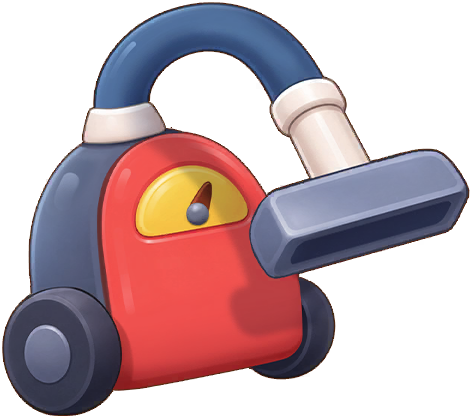
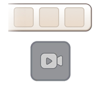

# Booster

[← Mục lục GDD](GDD.md)

Ảnh và bộ trợ giúp dưới đây giữ từ bản thảo Happy. Hướng feeling Happy chưa tự chốt giá, luật booster hoặc yêu cầu dùng lại hình icon.

| ID | Booster | Tác dụng | Mở khóa | Ảnh |
|---|---|---|---|---|
| B-001 | Vacuum | Hoàn thành ngay một hộp. | Level 3 |  |
| B-002 | Broom | Chuyển toàn bộ item trong slot chờ sang kho tạm. | Level 6 |  |
| B-003 | Extra Box | Mở thêm một hộp đang khóa, tối đa 3 hộp cùng lúc. | Chưa chốt level |  |
| B-004 | Extra Slot | Tăng chỗ chứa trong khay chờ. Có 2 slot bổ sung. | Chưa chốt level |  |

**Vacuum:** Bấm nút → dùng lượt hiện có hoặc chọn cách nhận → hút đồ để hoàn thành một hộp. Nếu không có hộp hợp lệ, báo không thể sử dụng. Quy tắc chọn hộp mục tiêu còn cần chốt.

**Broom:** Bấm nút → dùng lượt hoặc chọn cách nhận → chuyển đồ từ khay sang kho → tiếp tục thu gom. Nếu khay trống, báo không có item để dọn.

**Extra Box / Extra Slot:** Chạm vị trí khóa → mở lựa chọn nhận hỗ trợ → bổ sung sức chứa. Số slot mở mỗi lần và hiệu lực qua màn còn cần chốt.

**H-001 — Hint:** Sau 7 giây không thao tác, item phù hợp được gợi ý bằng viền vàng và nhịp phóng nhẹ. Đây là trợ giúp tự động, chưa đặt thành booster mua bằng coin.

Eagle Eye, Erase, Clear trả đồ về phòng và Undo của RoomSort chưa được đưa vào bộ booster này. Việc đổi level tham chiếu không tự thay đổi bộ booster.
