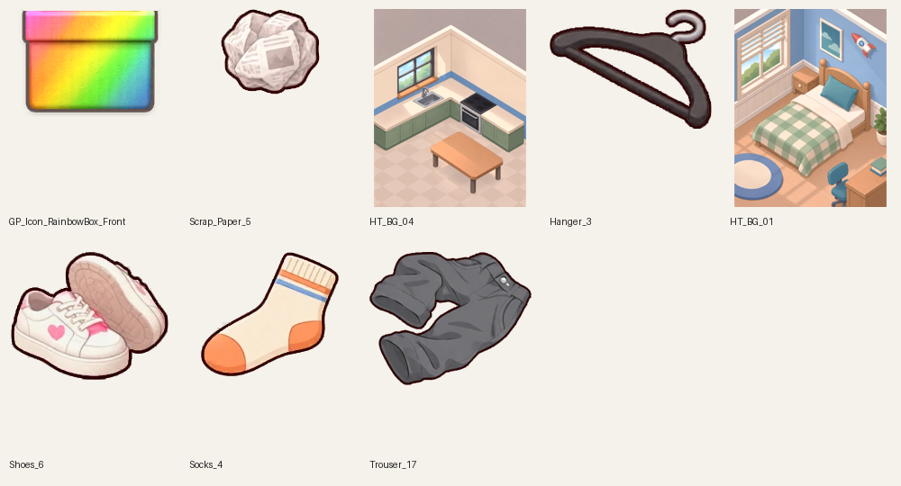

# Art direction

[← Mục lục GDD](GDD.md)

**Nguồn art chính: Tidy Room**, tại `D:\APK Works\Tidy Room\Tidy-Room_57_apkcube.apks`.

Tidy Room quyết định hình ảnh đồ vật và bối cảnh. Phạm vi dùng lại UI, icon booster và hiệu ứng hình ảnh cần đối chiếu sau khi xem tài nguyên; không mặc định toàn bộ UI cũng lấy từ Tidy Room.

Happy Tidy Room là tham chiếu về cảm giác thao tác và phản hồi: chọn đồ, nhịp nảy / bay, nhận đồ, đóng hộp, chuyển hộp và phản hồi booster. Dùng feeling Happy không có nghĩa dùng lại art Happy.

Các mẫu trong cùng nhóm phải dễ nhận là cùng loại dù khác màu hoặc kiểu dáng. Nhãn và icon hộp cần giúp người chơi hiểu nhóm nhận. Chưa mô tả màu, nét hoặc hình khối cụ thể của Tidy Room khi chưa xem hình trích xuất.

Ảnh Object, Booster và Tutorial hiện có đều từ Happy, được giữ để giải thích vai trò và trình tự. Chúng chưa phải hình đại diện của bộ art Tidy Room. Ảnh tĩnh không xác nhận đường bay hoặc nhịp chuyển động.
