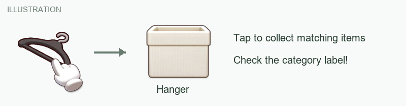
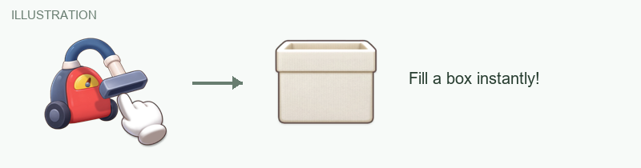
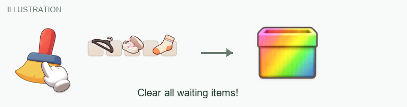
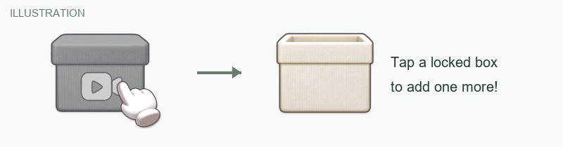

# Tutorial

[← Mục lục GDD](GDD.md)

| ID | Trigger | Hướng dẫn |
|---|---|---|
| T-001a | Vào level 1 | Chỉ item cần chọn: “Tap items that MATCH a box to tidy up!” |
| T-001b | Giới thiệu hộp | Làm nổi nhãn nhóm: “Check the category label!” |
| T-001c | Giới thiệu kéo màn | Chỉ hướng kéo: “Swipe left to find the last one!” |
| T-002 | Mở Vacuum tại level 3 | Chỉ nút Vacuum: “Fill a box instantly!” |
| T-003 | Mở Broom tại level 6 | Đặt 3 item vào slot chờ, chỉ nút Broom: “Clear all waiting items!” |
| T-004 | Giới thiệu Extra Box | Chỉ hộp khóa: “Tap a locked box to add one more!” Mốc level chưa chốt. |

Đây là hình ghép minh họa hướng dẫn. Khi đổi bộ level, cần kiểm tra lại rằng bố trí màn thực sự cho phép thực hiện từng bước tutorial.
