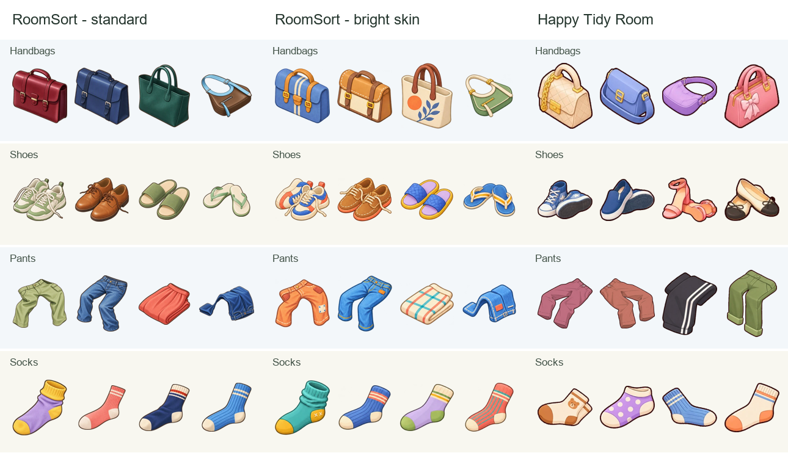

# RoomSort và Happy Tidy Room

RoomSort giữ cùng nền tảng chơi với Happy Tidy Room: tìm đồ theo nhóm, dọn vào hộp, dùng slot chờ và lấy đồ theo layer. Khác biệt đáng học nằm ở **thứ tự hộp, cách chia lượng đồ cho từng hộp và cách phối hợp chúng với đồ bị đè**. Dữ liệu ủng hộ việc dùng RoomSort làm tham khảo level design; chưa đủ để kết luận mọi màn của nó tốt hơn.

Phân tích bản RoomSort 1.0.18 và Happy Tidy Room 0.9 đã cung cấp. Đã đọc dữ liệu đóng gói và chạy mô phỏng bộ luật RoomSort; chưa chơi trực tiếp trên điện thoại. RoomSort có nhiều nhánh màn và art được chọn bằng cấu hình, nên màn người dùng đã chơi có thể khác màn nền mô tả dưới đây. Chưa xác minh lịch sử phát hành của hai game.

**1. Luật nền tương đồng, nhưng cách cứu tình huống có khác.**

| Nội dung | RoomSort | Happy Tidy Room |
|---|---|---|
| Hộp và khay ban đầu | 2 hộp mở, 5 slot chờ; có thể mở đến 3 hộp và 7 slot | Cùng cấu trúc 2 hộp, 5 slot chờ; thêm hộp và slot |
| Layer | Đồ phía trên chặn đồ phía dưới; thứ tự đồ quyết định quan hệ đè | Cũng có quan hệ đè và kiểm tra đồ được lấy |
| Khay đầy | Vẫn được chơi nếu còn item lấy được và đưa thẳng vào hộp. Nếu không còn nước trực tiếp mới thua | Chưa xác minh được chính xác điều kiện tương đương; mô tả khay đầy trong GDD hiện tại là bản rút gọn |
| Dọn khay | Bộ luật có chức năng trả 3 món từ khay về phòng, giữ lại vị trí và thứ tự layer ban đầu. Có nhánh chọn các món vào khay gần nhất | Broom chuyển toàn bộ đồ trong khay sang kho tạm |
| Trợ giúp khác | Có chức năng hoàn thành một hộp, Undo, xóa một item và gợi ý chủ động; việc hiện nút phụ thuộc nhánh tính năng | Đã xác định Vacuum, Broom, Extra Box, Extra Slot và gợi ý tự động |
| Gợi ý tự động | Sau 15 giây không thao tác, mặc định 3 lần mỗi màn; có nhánh cải thiện cách chọn gợi ý | Thời gian chờ cấu hình 7 giây |

Đã kiểm tra bằng tình huống mô phỏng: đưa đủ 5 item vào khay, game vẫn ở trạng thái chơi vì còn nước đưa đồ thẳng vào hộp. Sau đó vẫn hoàn thành được màn. Đây là logic trong bộ luật, không chỉ suy ra từ lời nhắc giao diện.

**2. RoomSort mở đầu bằng ít nhóm hơn, sau đó tăng lượng đồ mạnh hơn.**

| Dữ liệu màn | RoomSort: item / nhóm đồ / hộp | Happy Tidy Room: item / nhóm đồ / hộp |
|---|---:|---:|
| Màn nền 1 | 26 / 5 / 5 | 36 / 10 / 10 |
| Màn nền 2 | 80 / 15 / 16 | 57 / 13 / 14 |

RoomSort có nhiều màn thay thế cho ba màn đầu. Màn đầu mặc định tương thích dùng bộ My Room có khăn giấy, vẫn là 26 item, 5 nhóm, 5 hộp. Các nhánh khác có thể thay bằng phòng học, lối vào hoặc bộ phòng khác.

Màn nền 3 của RoomSort có 209 item, 23 nhóm và 41 hộp. Một nhánh Modern Living Room giảm xuống 147 item, 15 nhóm và 29 hộp. Vì vậy không nên coi một đường tăng 26 → 80 → 209 là trải nghiệm duy nhất của mọi người chơi.

Ý nghĩa thiết kế: màn đầu có ít nhãn phải nhớ để học luật; các màn sau mới tăng bài toán tìm kiếm và quản lý khay. Happy Tidy Room đưa nhiều nhóm nhỏ vào ngay màn đầu.

**3. Nhịp lặp hộp là điểm khác rõ nhất.**

Thống kê trên 130 màn nền RoomSort và 65 file màn Happy Tidy Room, gồm 60 file đánh số và 5 biến thể:

| Chỉ số | RoomSort | Happy Tidy Room |
|---|---:|---:|
| Số item trung vị mỗi file màn | 199 | 157 |
| Số nhóm đồ trung vị mỗi file màn | 22,5 | 18 |
| Số hộp trung vị mỗi file màn | 39 | 38 |
| Cỡ hộp phổ biến nhất | 5 item | 4 item; hộp 3 và 5 cũng phổ biến |
| Khoảng cách trung vị giữa hai hộp cùng nhóm | 16 vị trí | 10 vị trí |
| Hai hộp cùng nhóm đứng liền nhau | 0 trường hợp | 15 trường hợp |

Khoảng cách được tính theo vị trí trong hàng đợi hộp, không phải số thao tác hoặc thời gian chờ. Hai tập dữ liệu khác độ dài và Happy có file biến thể, nên đây là mô tả xu hướng, không phải bảng xếp hạng độ khó.

RoomSort thường yêu cầu dọn nhiều item hơn trong số hộp tương đối gần nhau. Một nhóm đã gặp còn có thể trở lại sau nhiều hộp khác. Điều này có thể tạo nhịp: nhìn thấy đồ sớm → phải giữ chỗ hoặc nhớ vị trí → giải phóng đồ khi nhóm đó quay lại. Ngược lại, nhiều hộp nhỏ giúp Happy Tidy Room có nhịp hoàn thành và thay hộp thường xuyên hơn.

**4. Cùng bố cục, đổi hàng đợi hộp đã thay đổi áp lực khay.**

RoomSort đóng gói bốn biến thể hàng đợi cho màn 2–3, kèm đường giải. Đã chạy lại cả 8 đường giải bằng chính bộ luật của game: **8/8 thắng, không bấm vào item đang bị chặn, chỉ dùng 2 hộp và 5 slot chờ**.

| Biến thể màn 3 | Item | Hộp | Số slot chờ dùng nhiều nhất trên đường giải có sẵn |
|---|---:|---:|---:|
| ladder_b_v1 | 209 | 51 | 5 |
| ladder_b_v2 | 209 | 42 | 2 |
| ladder_c_v1 | 147 | 33 | 3 |
| ladder_c_v2 | 147 | 29 | 3 |

Hai bản B giữ nguyên đồ và bố cục của màn nền, thay cách phân bổ và thứ tự hộp. Các bản C còn loại bớt nhóm đồ. Số slot trong bảng thuộc những đường giải cụ thể, **không phải số slot tối thiểu cần để thắng**, và không phải tỷ lệ thắng của người chơi.

Điểm nên học là cân bằng **bố cục + thứ tự hộp + sức chứa hộp** cùng nhau. Chỉ tăng số đồ hoặc độ chồng sẽ không tái tạo được nhịp chơi này.

**5. RoomSort có nhiều phương án thử nghiệm level hơn.**

Đã thấy một pool 35 lựa chọn bố cục cho màn 2, gồm bản gốc, và 50 bố cục thay thế cho màn 3. Lựa chọn ngẫu nhiên có cơ chế giữ ổn định theo lần cài đặt; không mặc định xáo lại mỗi lần chơi lại. Ngoài ra còn có các phòng được biên soạn riêng, nhánh đổi hàng đợi và dữ liệu tham chiếu độ khó/thời gian hoàn thành.

Đây là bằng chứng game có nhiều phương án hiệu chỉnh màn đầu. Có nhánh trong bản đóng gói không đồng nghĩa nhánh đó đang được bật cho tài khoản hoặc thị trường của người dùng. Không dùng các tham số thử nghiệm để khẳng định số liệu người chơi hiện tại.

**6. Art: nên so theo bộ đang dùng, không theo tổng số file.**

Ở các mẫu túi, giày, quần và tất: Happy Tidy Room có đường viền đậm, hình khối rõ, nhiều chi tiết trang trí và bảng màu tương đối thống nhất. RoomSort bộ thường có sắc độ trầm hơn; bộ bright thay đổi khá nhiều về màu và nét. Nhận xét chất lượng này dựa trên các mẫu đã xem, chưa phải đánh giá toàn bộ asset.

RoomSort có 2.303 ID đồ trong catalog nền; 2.163 ID xuất hiện trong 130 màn nền. Khi cộng các phòng thay thế mà bộ nạp đăng ký, có 3.717 ID; manifest ảnh tương ứng 3.532 đường dẫn ảnh riêng do có ID dùng chung ảnh. Hai skin bổ sung còn có 2.163 ánh xạ ảnh mỗi bộ. Happy Tidy Room có 2.863 ID đồ và đã đối chiếu đủ ảnh tương ứng. Các tổng này khác phạm vi, nên không dùng để kết luận game nào có art tốt hơn hoặc nhiều nội dung chơi hơn.

**Hướng áp dụng cho game đang phân tích:** lấy RoomSort làm tham khảo về nhịp hàng đợi hộp và phối hợp layer; giữ hướng mỹ thuật dễ đọc của Happy Tidy Room. Khi thay art, cần kiểm tra lại kích thước đồ, vùng chạm và quan hệ đè: hình mới có thể làm thay đổi cả độ khó dù tọa độ đặt đồ giữ nguyên. Nên kiểm thử lần lượt: hoàn thành không booster, mức đầy khay cao nhất, đoạn bị kẹt, thời gian tìm món và khả năng nhận đúng nhóm.

**Dữ liệu để tra cứu**

- `level-metrics.csv`: số item, nhóm, hộp và nhịp lặp nhóm của từng file màn ở hai game.
- `solver-proof-check.csv`: kết quả chạy lại 8 đường giải RoomSort.
- Mã đã trích: `D:/APK Works/RoomSort/analysis/www/game/src/`.
- Luật và trợ giúp: `core/game.js`, `core/rules.js`.
- Hàng đợi và đường giải: `data/deal-variants.js`, `services/deal-variant.js`.
- Bố cục và nhánh màn: `services/room-content.js`, `services/workshop-experiment.js`, `services/level2-layout-pool.js`, `services/level3-layout-pool.js`.
- Màn nền: `assets/art/v3_review_20261104/catalog.json`; ảnh và skin: manifest cùng thư mục và `assets/art/theme_trials_20261112/manifest.json`.
- Happy Tidy Room: `D:/APK Works/HappyTidyRoom/analysis/unity/*level_*.txt`, catalog và GameplayConfig trong `analysis/mono/`.
